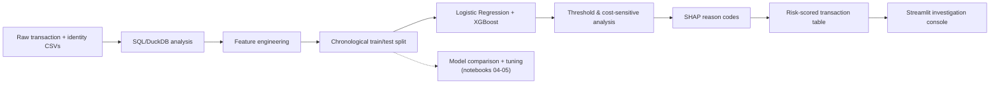

# ValidaX: Digital Payments Fraud & Identity Risk Investigation Engine

**Python, SQL (DuckDB), scikit-learn, XGBoost, SHAP, Streamlit** · Live demo: https://validax.streamlit.app

ValidaX is a machine learning system that detects fraudulent e-commerce transactions and
classifies each one as **fraudulent or legitimate**, helping reduce financial losses and
improve transaction security. Every prediction comes with a probability, a cost-optimal
decision threshold and plain-language reasons, so investigators can review the riskiest
transactions first.

CSE303 Capstone Project (v2). Proposal: [PROPOSAL.md](PROPOSAL.md) · Final report: [REPORT.md](REPORT.md)

> **Project status.** The core pipeline (notebooks 01–03, `src/`, `outputs/`, `app/`) has
> been run on the real IEEE-CIS data, and every result quoted below comes from that run.
> `notebooks/04_model_comparison.ipynb` and `notebooks/05_tuning_and_benchmark.ipynb`
> have also been run on the real data. Their results are in [REPORT.md](REPORT.md)
> (Sections 5 and 6). The deployed model in `app/model.pkl` is the main pipeline model;
> tuning did not replace it.

## Problem

A payments/e-commerce fraud team receives far more transactions than investigators can
manually review. Fraud is rare (~3.5% of traffic here) and investigation capacity is
fixed — so the real product isn't "detect fraud," it's: **which transactions should an
investigator look at first, why, and what happens to fraud capture and false-positive
workload as the review threshold moves.**

## Solution

An end-to-end fraud analytics workflow: SQL-based exploratory analysis → interpretable +
masked feature engineering → an XGBoost risk model benchmarked against a logistic
regression baseline → threshold and cost-sensitive decisioning → SHAP-based reason codes
→ a six-page Streamlit app that classifies single transactions (form) and uploaded batches
(CSV) as fraudulent or legitimate, alongside the investigation console.

## Dataset

**[IEEE-CIS Fraud Detection](https://www.kaggle.com/competitions/ieee-fraud-detection)**
(Kaggle competition, data provided by Vesta Corporation) — **real, anonymized**
e-commerce transactions, not synthetic. 590,540 labeled transactions
(`train_transaction.csv`, 394 columns) optionally joined to identity/device signals
(`train_identity.csv`, 41 columns, ~24% match rate) on `TransactionID`.

**Why this dataset over alternatives considered** (PaySim, Credit Card Fraud/ULB,
BankSim, Sparkov): it's the only one where the strongest predictors are *both*
high-performing *and* at least partially interpretable to a human investigator — email
domain, card network/type, device, product code, and derived transaction velocity, on
top of Vesta's masked engineered features. Anonymized-PCA datasets (Credit Card
Fraud/ULB) can't support investigator-facing reason codes at all, since every predictive
feature is an opaque principal component.

**Masked columns — a firm project rule:** `C1-C14` (counting), `D1-D15` (timedelta),
`M1-M9` (match flags), `V1-V339` (Vesta engineered features), and most `id_*` columns
have their *exact* real-world meaning masked by Vesta. This project uses them as opaque
numeric/categorical model inputs everywhere (feature engineering, SHAP output, dashboard
reason codes) and **never invents a specific interpretation for any individual masked
column**. They're always labeled generically by family, consistent with the competition's
own data description:

| Family | Generic label (as shown in reason codes) |
|---|---|
| `C1-C14` | masked counting feature (e.g. "masked counting feature (C14)") |
| `D1-D15` | masked time-delta feature |
| `M1-M9` | masked match flag |
| `V1-V339` | masked Vesta-engineered feature |
| `id_*` | masked identity/device signal |

Kaggle's `test_transaction.csv` / `test_identity.csv` have no fraud labels (they exist
only for the competition leaderboard) and are not used here. This project instead splits
its own chronological train/test set out of the 590,540 labeled rows.

## Architecture



## Repo structure

The CSE303-required paths (`app/app.py`, `app/model.pkl`, `notebooks/01-05`, `src/*.py`,
`PROPOSAL.md`, `REPORT.md`) are kept exactly as specified. Tooling, tests, SQL and
deployment files sit around them. Nothing in the code depends on the folder name
(the course submission name is `cse303-ml-fraud-detection/`).

```
ValidaX/
├── README.md                          overview, setup, deployment (this file)
├── PROPOSAL.md                        CSE303 project proposal
├── REPORT.md                          project report
├── requirements.txt                   full pinned environment (app + SQL + notebooks)
├── requirements-app.txt               pinned runtime dependencies (Docker image, CI)
├── pyproject.toml                     project metadata, pytest and ruff configuration
├── Makefile                           shortcuts: install, lint, test, pipeline, app, docker
├── Dockerfile                         production image for the Streamlit console
├── .dockerignore                      keeps data/, notebooks, tests and the venv out of the image
├── .github/workflows/ci.yml           CI: lint, tests, Docker build + health check
├── .gitignore / .gitattributes / .editorconfig
├── app/
│   ├── app.py                         6-page Streamlit app: classify, batch, investigate
│   └── model.pkl                      trained bundle: XGBoost + logistic baseline +
│                                      feature list + cost-optimal threshold
├── src/
│   ├── data_processing.py             load, merge, clean, downcast dtypes, split checks
│   ├── features.py                    interpretable + masked-family feature engineering
│   ├── model.py                       chronological split, all models, tuning, clustering,
│   │                                  threshold/cost/capacity analysis, SHAP
│   ├── scoring.py                     risk-scored table + SHAP reason codes
│   ├── inference.py                   new transactions -> model features (form + CSV upload)
│   └── interpretable_model.py         trains the 29-feature form model
├── artifacts/                         inference metadata, card history, form model (+ summary)
├── notebooks/
│   ├── 01_eda.ipynb                   fraud rates, amount/time distributions, missingness
│   ├── 02_preprocessing.ipynb         cleaning + interpretable/masked feature construction
│   ├── 03_baseline_model.ipynb        logistic baseline vs. XGBoost, thresholds, cost curve, SHAP
│   ├── 04_model_comparison.ipynb      Decision Tree, PCA, Naive Bayes, SVM, ANN vs. XGBoost
│   └── 05_tuning_and_benchmark.ipynb  RF/XGBoost tuning, benchmark, alert clustering
├── sql/
│   └── fraud_analysis.sql             DuckDB analysis over the raw Kaggle tables
├── scripts/
│   └── run_app.sh                     startup script: file checks, threads, port 8501
├── tests/                             unit + smoke tests (pytest; no Kaggle data needed)
├── outputs/                           results of the completed run on the real data
│   ├── model_summary.json             ROC-AUC / PR-AUC, split sizes, cost-optimal threshold
│   ├── threshold_sweep.csv            alerts / precision / recall at thresholds 0.1-0.9
│   ├── cost_sensitive_threshold.csv   scenario cost at thresholds 0.02-0.96
│   ├── daily_capacity_simulation.csv  per-day fraud capture at 500 alerts/day
│   ├── feature_importance.csv         global mean |SHAP| per feature
│   ├── scored_transactions.csv        test-window scores, risk tiers, top-3 reason codes
│   ├── shap_summary.png               global SHAP summary plot
│   ├── model_comparison.csv           notebook 04: model ladder results
│   ├── xgb_tuning_trials.csv          notebook 05: XGBoost search
│   ├── rf_tuning_trials.csv           notebook 05: Random Forest search
│   ├── tuning_benchmark.csv           notebook 05: mean ± std, cost and capacity benchmark
│   └── alert_clusters.csv             notebook 05: K-means alert segments
└── data/
    ├── raw/.gitkeep                   put the Kaggle CSVs here (git-ignored)
    └── processed/.gitkeep             parquet files written by the pipeline (git-ignored)
```

Running notebooks 04 and 05 adds `outputs/model_comparison.csv`,
`outputs/xgb_tuning_trials.csv`, `outputs/tuning_benchmark.csv` and
`outputs/alert_clusters.csv`. They don't overwrite any existing output.

## Setup

Create a virtual environment and install the requirements. `xgboost` and `shap` are
required: `src/model.py` imports both, so every notebook from 03 onward needs them.

```bash
python -m venv .venv
.venv\Scripts\activate            # Windows; on macOS/Linux: source .venv/bin/activate
pip install -r requirements.txt
```

On Windows, `jupyterlab` can fail to install unless long-path support is enabled. The
notebooks still run without it through `jupyter nbconvert` or the VS Code notebook editor
(that needs `nbconvert` and `ipykernel`). Make sure the notebook kernel is the `.venv`
interpreter and not a global Python.

Download the data yourself. This requires accepting the Kaggle competition rules, which
this project does not and cannot bypass. From
[kaggle.com/competitions/ieee-fraud-detection/data](https://www.kaggle.com/competitions/ieee-fraud-detection/data),
get `train_transaction.csv` and `train_identity.csv` and place them in `data/raw/`.

Then run the pipeline end to end, from the repository root:

```bash
python src/data_processing.py   # -> data/processed/transactions_clean.parquet
python src/features.py          # -> data/processed/transactions_features.parquet
python src/model.py             # trains baseline + XGBoost; writes outputs/ + app/model.pkl
python src/scoring.py           # -> outputs/scored_transactions.csv
streamlit run app/app.py        # reads app/model.pkl + outputs/
```

`src/model.py`, `src/scoring.py` and notebook 03 **overwrite** the files in `outputs/`
and `app/model.pkl`. Re-run them only if you mean to replace the results quoted in this
README and in REPORT.md.

**Notebooks.** Run the notebooks from inside `notebooks/` in order:

| Notebook | Needs | Status |
|---|---|---|
| `01_eda.ipynb` | raw CSVs | run, outputs saved |
| `02_preprocessing.ipynb` | `transactions_clean.parquet` | run, outputs saved |
| `03_baseline_model.ipynb` | `transactions_features.parquet`, `xgboost`, `shap` | run, outputs saved |
| `04_model_comparison.ipynb` | `transactions_features.parquet`, `xgboost`, `shap` | run, outputs saved (REPORT.md §5) |
| `05_tuning_and_benchmark.ipynb` | `transactions_features.parquet`, `xgboost`, `shap` | run, outputs saved (REPORT.md §6) |

Notebook 05 only replaces `app/model.pkl` if you set `PROMOTE_TUNED_MODEL = True` in its
last cell. It is off by default.

SQL analysis, from the repository root: `duckdb -c ".read sql/fraud_analysis.sql"`
(or run `sql/fraud_analysis.sql` from Python with `duckdb`).

## Using the app

**Live demo:** https://validax.streamlit.app

| Page | What it does |
|---|---|
| **Classify a transaction** | Enter one transaction (amount, product, card network and type, email domains, device, relative time, billing codes, card history) and get **Fraudulent** or **Legitimate**, the fraud probability, the decision threshold and the top reasons. Uses the form model (29 interpretable fields), because the 416 masked Vesta columns can't be typed in. |
| **Batch classification** | Upload a CSV in the IEEE-CIS format (the columns of Kaggle's `train/test_transaction.csv`, optionally with the identity file) and get every row labelled **Fraudulent** or **Legitimate** by the main 451-feature model, with risk tier and reason codes, plus a downloadable results file. If the file has an `isFraud` column, the page also scores itself against it. |
| **Fraud overview** | Test-window metrics, the risk ladder, the classification at the deployed threshold, global SHAP drivers and the model benchmarks. |
| **Alert queue** | Filterable triage list of scored test transactions, plus the K-means alert segments. |
| **Transaction investigation** | One test-window transaction: score, decision, card history and SHAP reason codes. |
| **Threshold simulator** | Fraudulent-vs-legitimate counts, precision/recall/F1, cost and alerts per day at any threshold. |

**Try batch classification:** download `test_transaction.csv` (and optionally
`test_identity.csv`) from the Kaggle competition, take the first few thousand rows, and
upload them. These are real transactions from after the labeled window, so the card history
used for them is point-in-time correct.

**How a new transaction is prepared:** `src/inference.py` rebuilds exactly the training
features. Checked on 20,000 test-window rows: the rebuilt features equal the stored ones
and the predictions match to 0.0. It uses three files in `artifacts/`:

- `inference_metadata.json`: the training category lists, so categorical encodings can't shift;
- `card_history.csv`: a per-card summary, so "prior transactions" features work without the raw data;
- `interpretable_model.pkl`: the form model.

`make artifacts` rebuilds them from `data/processed/`.

## Deployment

The app is read-only. It reads `app/model.pkl`, `artifacts/`, the files in `outputs/`
and, for live SHAP explanations on the Transaction investigation page,
`data/processed/transactions_features.parquet`. It never writes to any of them. Uploaded
CSVs are processed in memory and never stored.

### Local

From the repository root, with the virtual environment active:

```bash
streamlit run app/app.py
```

Or use the startup script. It checks the required files, sets thread limits
(`OMP_NUM_THREADS=4` by default), binds port 8501 on all interfaces and runs headless:

```bash
./scripts/run_app.sh                # macOS/Linux, or Git Bash on Windows
PORT=8600 ./scripts/run_app.sh      # another port
```

Then open http://localhost:8501.

### Docker

The image (`Dockerfile`, Python 3.13 slim) installs the pinned runtime dependencies from
`requirements-app.txt`. It contains `app/`, `src/` and `outputs/` as read-only files and
runs as an unprivileged user. The Kaggle-derived feature table is **not** baked into the
image (`.dockerignore` excludes `data/`). Mount it read-only to enable live SHAP
explanations.

```bash
# Build
docker build -t validax-console .

# Run: 4 GB memory cap (no extra swap), 4 CPUs, read-only root filesystem (scratch in an
# in-memory /tmp), port 8501, feature table mounted read-only
docker run -d --name validax \
  --memory=4g --memory-swap=4g --cpus=4 \
  --read-only --tmpfs /tmp \
  -e OMP_NUM_THREADS=4 \
  -p 8501:8501 \
  -v "$(pwd)/data/processed:/srv/fraud-console/data/processed:ro" \
  validax-console

# Health: Docker polls /_stcore/health every 30 s (status shows in `docker ps`)
docker inspect --format '{{.State.Health.Status}}' validax
curl -fsS http://localhost:8501/_stcore/health        # prints "ok"

# Logs / stop
docker logs -f validax
docker stop validax && docker rm validax
```

On Windows PowerShell, use `${PWD}` instead of `$(pwd)` and a backtick instead of `\` for
line continuation. Without the `-v` mount the app still runs: the Transaction investigation
page shows a note in place of live SHAP explanations.

**Memory.** About 4 GB is recommended. The Transaction investigation page loads the full
test-window feature table, about 2 GB at peak. `scripts/run_app.sh` prints the container's memory
limit at startup and warns if it is below 3 GB (`MIN_MEMORY_MB`). If port 8501 is
already taken on the host, map another one, e.g. `-p 8502:8501`. The container still
listens on 8501 inside.

**Updating the model.** The image only reads artifacts. To deploy a retrained model, run
the pipeline (`src/model.py`, `src/scoring.py`) outside the container, review the new
`app/model.pkl` and `outputs/`, then rebuild the image.

### Development: tests, lint and CI

```bash
pip install -r requirements.txt pytest==9.2.0 ruff==0.17.6   # or: make install-dev
python -m pytest                                             # unit + smoke tests (make test)
python -m ruff check src app tests                           # lint (make lint)
```

The tests use small synthetic frames plus the committed `outputs/`, so they don't need the
Kaggle data. They cover:

- no future leakage in the velocity features;
- the 472,432 / 118,108 split checks;
- family-only labels for masked columns;
- the cost, capacity and promotion guards;
- the console helpers;
- a headless render of the Overview, Alert queue and Threshold simulator pages, which also
  confirms nothing in `outputs/` or `app/model.pkl` is written.

GitHub Actions (`.github/workflows/ci.yml`) runs lint and tests on every push and pull
request, then builds the Docker image and waits for its health check. `make help` lists the
other shortcuts.

### Operational disclaimer

The console supports **human review**. A score, tier or "Flag for review" decision
indicates **elevated risk warranting review by an investigator**. It is **not an automated
determination of fraud**, and it must not be used on its own to block, decline or reverse
transactions. The $500 / $10 costs and the 500 alerts/day capacity behind the operating
threshold are scenario assumptions, not industry figures.

## Key features

- **Chronological train/test split** (first 80% of transaction time → train, last 20% →
  test) instead of a random split — the model is validated the way it's actually used:
  scoring transactions it has never seen, that happen *after* everything it trained on.
- **Point-in-time behavioral/velocity features**, grouped by `card1` (a high-cardinality,
  low-missingness card-attribute code used here as a pseudo account identifier): prior
  transaction count, average/max prior amount, time since last transaction. Computed
  with expanding windows ordered by time, so no feature ever leaks future information.
- **Interpretable vs. masked feature separation**, carried through consistently from
  feature engineering into SHAP output and dashboard reason codes.
- **Threshold sweep, fixed-capacity simulation (Fraud Capture@K), and cost-sensitive
  threshold optimization** — turning a probability into an operational decision, not
  just a metric.
- **SHAP local + global explanations** feeding plain-English reason codes in the
  dashboard.

## Model evaluation (this run — chronological split, 472,432 train / 118,108 test rows)

| Model | ROC-AUC | PR-AUC |
|---|---|---|
| Logistic Regression (interpretable features only) | 0.757 | 0.143 |
| **XGBoost** (interpretable + masked features, 451 total) | **0.891** | **0.488** |
| XGBoost form model (29 interpretable features; Classify a transaction page) | 0.818 | 0.218 |

PR-AUC is the metric that matters here, not accuracy: fraud is ~3.5% of test
transactions, so a model that never alerts would score >96% accuracy while catching zero
fraud.

**Threshold trade-off** (full sweep in `outputs/threshold_sweep.csv`):

| Threshold | Alerts | Precision | Recall |
|---|---|---|---|
| 0.1 | 71,848 | 5.4% | 95.3% |
| 0.3 | 24,379 | 13.7% | 82.0% |
| 0.5 | 11,106 | 24.9% | 68.1% |
| 0.7 | 4,820 | 43.2% | 51.2% |
| 0.9 | 1,530 | 75.2% | 28.3% |

**Fixed investigation capacity** — assuming investigators can review 500 alerts/day,
simulated per day across the test period (`outputs/daily_capacity_simulation.csv`):
captures **~79.3%** of each day's fraud on average, at **~15.4%** average precision. A
single global top-500 cut over the whole test window (a less realistic, one-shot version
of the same idea) reaches 93.8% precision but only 11.5% recall, since it concentrates
review on the very highest-confidence cases only.

**Cost-sensitive threshold** — assuming (explicitly a scenario assumption, not a real
industry figure) a missed fraud costs $500 and a false-positive investigation costs $10:
the cost-minimizing threshold is a **0.24 probability threshold** (precision 10.8%, recall
86.4%, total scenario cost $566,840, against $731,890 at the default 0.5; see
`outputs/cost_sensitive_threshold.csv`). At this imbalance of assumed costs, the model
correctly favors high recall, because missing a fraud is 50x more expensive than an
unnecessary review.

**Top global SHAP drivers**: `P_emaildomain`, masked counting features `C14`/`C13`/`C1`,
`card6` (card type), `TransactionAmt`, and several masked Vesta features (`V70`, `V294`)
and masked identity/device signal (`id_31`). Full ranking in `outputs/feature_importance.csv`. Note
that several of the strongest predictors are masked — this is real, honestly reported
behavior of the dataset, not a modeling choice; interpretable features (email domain,
amount, card type, card velocity) are still consistently in the top 10. The global plot
is `outputs/shap_summary.png`, which the app shows on its Fraud Overview page.

**Model comparison and tuning:** XGBoost leads the full model ladder (PR-AUC 0.4862 in the
notebook 04 retrain). A fast tuning pass did not beat its default parameters, so the
deployed model was kept. Details are in REPORT.md Sections 5–6.

## Limitations

- IEEE-CIS is real transaction data but from a single provider (Vesta) and a fixed
  ~6-month window. Model behavior will not directly transfer to a different payments
  product, geography, or era of fraud tactics.
- `TransactionDT` is a relative time offset, not a calendar timestamp — no real
  day-of-week/holiday seasonality can be derived from it beyond the mod-based buckets
  used here.
- Several of the model's strongest features are masked by the data provider; this
  project deliberately does not guess their meaning, which limits how much of the
  model's behavior can be explained to a human reviewer.
- Risk tiers (Critical/High/Medium/Low at 0.8/0.6/0.3) and the $500/$10 cost assumptions
  are project operating rules for this demo, not validated industry benchmarks.
- No real investigator feedback loop and no production transaction stream.

**Operational disclaimer:** this project's model output indicates **elevated risk
warranting review**. It is not a determination that a transaction is fraudulent, and it
should not be used to block transactions automatically.
